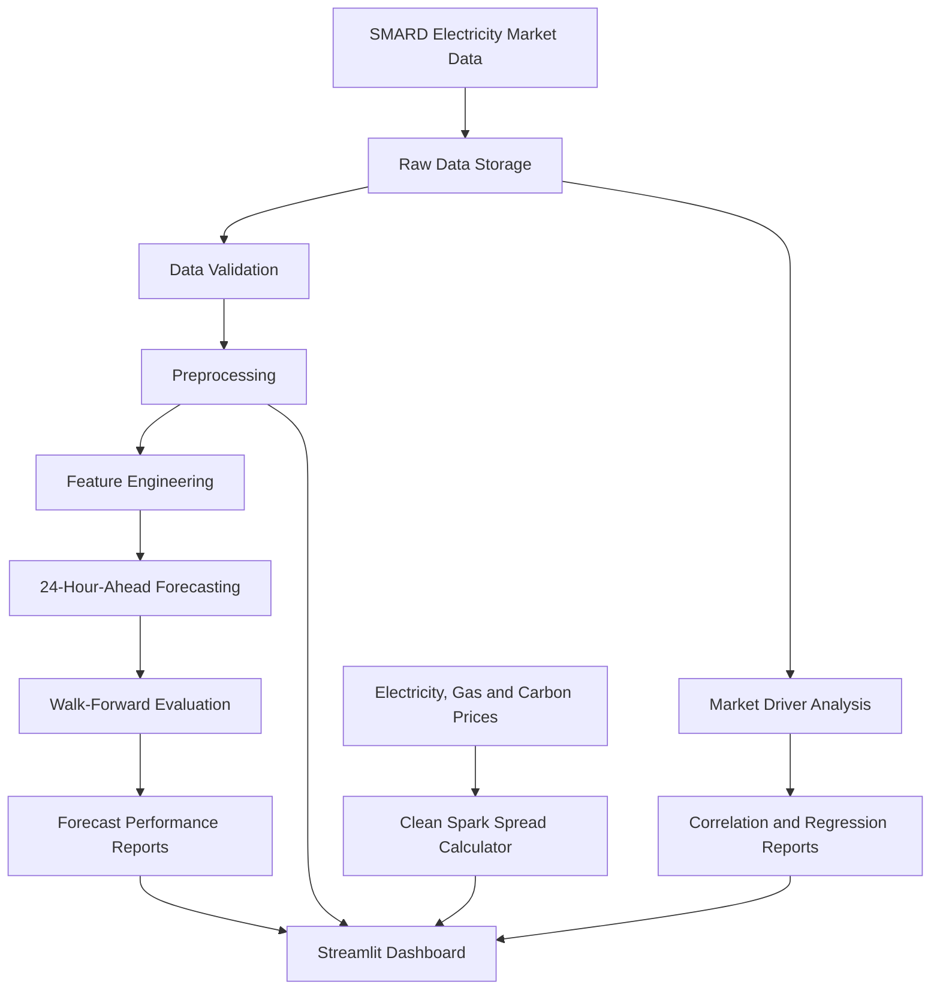
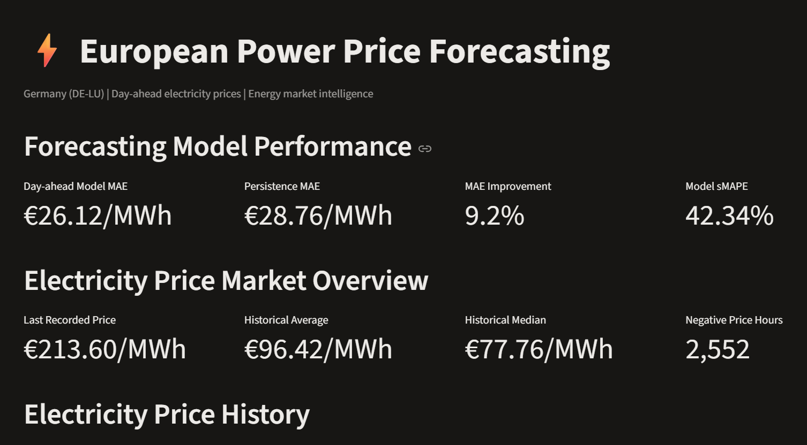


# European Power Price Forecasting & Energy Market Intelligence System

A data science and machine learning project for analysing and forecasting day-ahead electricity prices in Germany's DE-LU bidding zone.

The project combines historical electricity price analysis, time-series feature engineering, machine learning, energy market driver analysis, and gas-fired power generation economics in an interactive Streamlit dashboard.

## Project Overview

**Market:** Germany (DE-LU)  
**Target:** Day-ahead wholesale electricity price  
**Forecast horizon:** 24 hours  
**Price unit:** EUR/MWh  
**Data frequency:** Hourly  

### Key Results

| Evaluation metric | Result |
|---|---:|
| Day-ahead model MAE | €26.12/MWh |
| Persistence baseline MAE | €28.76/MWh |
| MAE improvement | 9.2% |
| Day-ahead model sMAPE | 42.34% |
| Walk-forward validation folds | 4 |

The day-ahead model outperformed the persistence benchmark in all four chronological evaluation folds.

These results represent the current historical evaluation dataset and should not be interpreted as guaranteed future forecasting performance.

## System Architecture



## Project Components

### 1. Data Collection and Processing

- Historical German day-ahead electricity prices from SMARD.
- Hourly electricity price dataset.
- Quarter-hour electricity price dataset.
- Hourly grid load, offshore wind, onshore wind and solar generation observations.
- Timestamp standardisation and data quality validation.
- Quarter-hour to hourly price aggregation and reconciliation.

### 2. Exploratory Data Analysis

Analyses include:

- Electricity price distributions.
- Historical price movements.
- Monthly average prices.
- Hourly price patterns.
- Negative electricity price frequency.
- Missing observations and data quality.

### 3. Feature Engineering

Historical price and calendar features include:

- Previous-hour price.
- 24-hour, 48-hour and 168-hour price lags.
- Historical rolling averages.
- Rolling price volatility.
- Hour of day.
- Day of week.
- Month and weekend indicators.

### 4. Machine Learning and Forecast Evaluation

Models and benchmarks developed:

- Persistence baseline.
- Linear regression.
- Custom gradient boosting benchmark.
- Day-ahead forecasting model.

Evaluation methodology:

- Chronological training and testing.
- Expanding-window walk-forward validation.
- Mean Absolute Error (MAE).
- Symmetric Mean Absolute Percentage Error (sMAPE).

The final day-ahead model uses historical price and calendar features. Historical actual grid load and renewable generation are analysed separately; they are not treated as verified day-ahead forecast inputs.

### 5. Energy Market Driver Analysis

The project explores relationships between electricity prices and:

- Grid load.
- Offshore wind generation.
- Onshore wind generation.
- Solar generation.

The current driver analysis is based on a limited 30-day sample of contemporaneous observations. Correlations are exploratory and do not establish causation or prove day-ahead predictive value.

### 6. Clean Spark Spread Analysis

A configurable calculator estimates the clean spark spread for gas-fired electricity generation.

It considers:

- Electricity selling price.
- Natural gas price.
- Carbon allowance price.
- Power plant efficiency.
- Emissions factor.

The calculation is a simplified operating spread, not net profit. It excludes additional operating and maintenance costs, start-up costs and other plant-specific expenses.

## Interactive Dashboard

The Streamlit dashboard brings together:

- Forecasting model performance.
- Persistence benchmark comparison.
- Historical electricity price overview.
- Electricity price history chart.
- Walk-forward validation results.
- Energy market driver analysis.
- Interactive clean spark spread calculator.

### Dashboard Preview

The dashboard preview is included below.

## Technology Stack

| Area | Technologies |
|---|---|
| Programming | Python |
| Data analysis | Pandas, NumPy |
| Machine learning | Custom NumPy implementations, scikit-learn exploration |
| Visualisation | Matplotlib, Streamlit |
| Data source | SMARD |
| Testing | Pytest |
| Development | VS Code, Git, GitHub |

## Project Structure

```text
European_Power_Price_Forecasting/
│
├── app/
│   └── dashboard.py
│
├── config/
│
├── data/
│   ├── raw/
│   └── processed/
│
├── notebooks/
│
├── reports/
│   ├── figures/
│   ├── day_ahead_walk_forward_results.csv
│   ├── baseline_evaluation.csv
│   ├── linear_regression_evaluation.csv
│   ├── energy_driver_correlations.csv
│   └── preprocessing_quality_report.csv
│
├── src/
│   ├── data/
│   ├── features/
│   ├── models/
│   ├── evaluation/
│   └── economics/
│
├── tests/
│
├── .env.example
├── .gitignore
├── requirements.txt
└── README.md
```

## Installation and Setup

### 1. Clone the repository

```bash
git clone https://github.com/arjavianup523/European-power-price-forecasting.git
cd European-power-price-forecasting
```

### 2. Create a virtual environment

```bash
python -m venv .venv
```

Activate it on Windows:

```powershell
.venv\Scripts\Activate.ps1
```

### 3. Install dependencies

```bash
python -m pip install -r requirements.txt
```

### 4. Prepare the datasets

Place the required SMARD raw and processed datasets in their corresponding `data/` directories.

The dashboard and evaluation scripts expect the generated reports and processed datasets to exist.

### 5. Run the forecasting evaluation

```bash
python -m src.models.run_day_ahead_forecasting
```

### 6. Run the energy economics calculator

```bash
python -m src.economics.clean_spark_spread --electricity 120 --gas 35 --carbon 80
```

### 7. Launch the dashboard

```bash
python -m streamlit run app/dashboard.py
```

## Data Sources

- [SMARD – German Electricity Market Data](https://www.smard.de/en)
- [ENTSO-E Transparency Platform](https://transparency.entsoe.eu/)

Data availability, publication timestamps and redistribution permissions must be checked before using the data for operational forecasting or redistribution.

## Limitations and Future Improvements

- Incorporate verified historical day-ahead load and renewable generation forecast vintages.
- Add historical natural gas and carbon market data.
- Expand market driver analysis across a longer historical period.
- Evaluate additional forecasting models.
- Strengthen time-series validation and forecast-origin controls.
- Add a FastAPI backend and deployment workflow.
- Improve automated testing and monitoring.

## Disclaimer

This is an educational and portfolio research project. It is not a production electricity trading system and does not provide investment or trading advice.



**Live Dashboard:** https://european-power-price-forecasting-83hmc9wufvfgw5wzmtduel.streamlit.app/